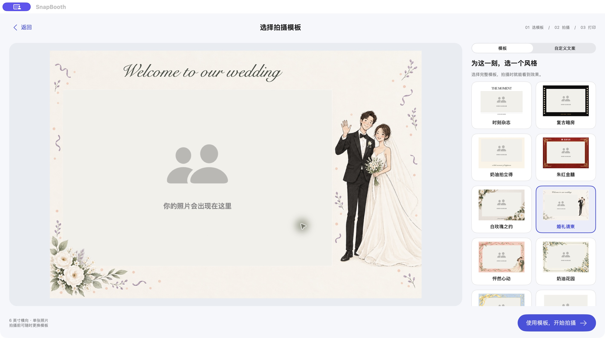
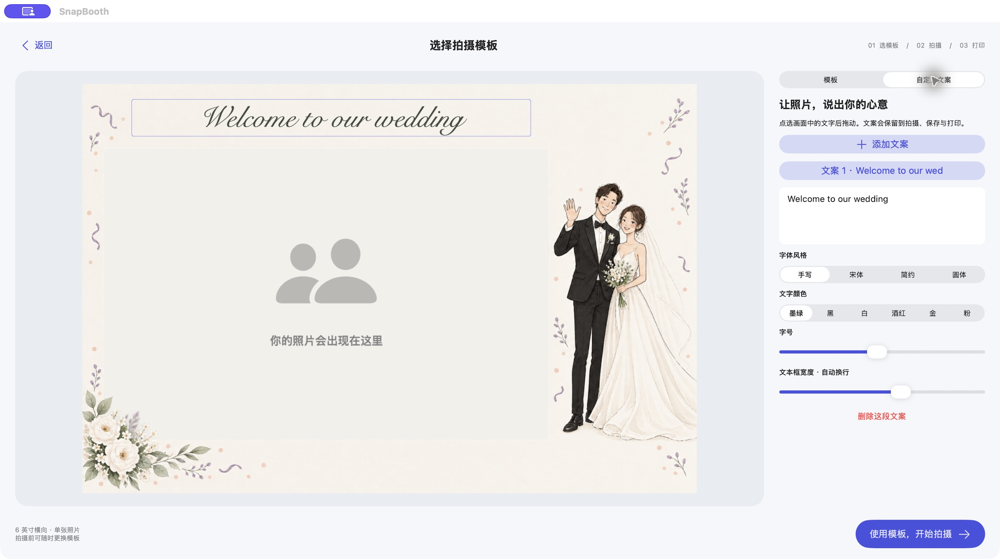
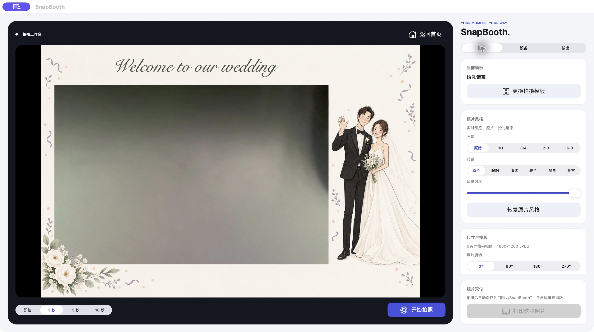
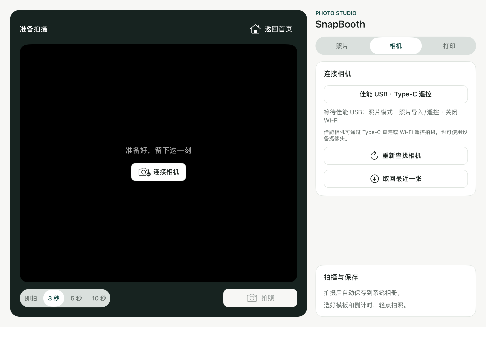

# SnapBooth

SnapBooth 是面向活动现场的现拍现打 App。**iPad 是主平台**：iPad 新增 USB/PTP 直连 EOS R50 V 真快门链路（已在 iPad + R50 V 真机验证拍摄及照片回传），并保留 Canon CCAPI/Wi-Fi 链路，自动下载、保存、排版，再通过系统分享把成片交给米家 App，由用户在米家确认打印。Mac 版仅作为 USB 协议验证、开发调试和应急备用，不作为产品主链路。

## 旧版界面预览（2026-10-01）

以下为 2026-10-01 截取的 Mac Catalyst 旧版运行界面，不代表当前版本的配色、按钮和布局。当前界面说明见“当前版本”和“工作台 UI”；iPad 与 Mac 的设备连接和打印入口仍有区别。

### 活动首页

婚礼欢迎页支持编辑活动背景和文案。点击“开始拍摄”进入模板选择。


### 拍摄前选择模板

先选择边框再拍照，提供杂志、胶片、拍立得、中式红金、写实花卉及插画等风格。



### 自定义文案

支持添加多段文字、选择字体与颜色、调整字号和文本框宽度，并在预览画面中拖动位置。



### 拍摄工作台

旧版取景时即可看到模板和文字，右侧分为“照片 / 设备 / 输出”设置。支持即拍及 3、5、10 秒倒计时；倒计时使用透明背景的大号白色数字和逐渐缩短的进度圆环。下图为旧版实时取景界面，尚未触发拍摄。



## iPad 主链路状态

- EOS R50 V：已接入 Canon CCAPI。iPad 可通过 HTTP/HTTPS Wi-Fi 实时取景、触发真快门与 AD-E1 热靴闪光，并从存储卡自动下载新增 JPEG；支持佳能 Digest 用户认证，自签名证书仅对所配置的相机主机放行，密码保存在 iPad 钥匙串。UVC 只作为无闪光备用取景。
- 米家桌面照片打印机 2：iPad 默认“米家打印”模式。拍摄后点击“去米家打印”弹出系统分享面板，选择米家（未显示时查看“更多”）。边框和模板在拍摄前设置，实时取景、拍后预览与分享图片使用同一套合成效果。由米家选择匹配的相纸并确认打印，需保留完整图片，避免二次边框或裁切。用户已验证 SnapBooth 分享可以进入米家；分享完成不代表打印完成，取消分享保留当前照片。不提供私有 BLE 直连打印。
- AirPrint：仅作为其他兼容打印机的备选。当前这台二代打印机未在局域网公告 IPP/IPPS 服务。
- USB 直连排查：iPad 的“打印 → 相纸与设备检测 → USB 设备检测”提供系统相机设备与 ExternalAccessory 的只读检测，可复制、分享报告。它不会创建打印任务；当前尚未实现 A16 iPad 的米家 USB 直接打印。
- iPad 验收标准：所有主功能必须在 iPad 真机完成。Mac Catalyst 构建通过只用于防止备用版回归，不代表 iPad 主链路已完成。

## 当前版本：0.7.0 / build 39

统一全部 10 款模板的单张照片窗口为横向 3:2。装饰模板在 `1800×1200` 画布上的照片区域为 `1440×960`，默认标题和装饰均留在照片区域之外；纯净款的可选边框也保持 3:2。3:2 原片可完整填满照片窗口，其他比例继续等比完整显示，必要时留白。证件照和多张拼版仍按各自规格处理。

重新生成六款简洁质感边框：誓言留白、柔雾玫瑰、鼠尾草花园、朱砂金线、白玫瑰之约、晴蓝金线。采用花材、纸张与细金线，移除大幅卡通人物；运行时统一保护照片窗口，避免素材的不规则透明边缘遮住照片。默认文案仍可编辑、移动或删除；用户主动拖入照片区域的文字会保留。素材路径、完整生成提示词及检查图见 [边框生成记录](docs/design/frames-3x2-2026-10-31.md)。

工作台取景区右上角新增“收起设置 / 展开设置”。收起后取景区占用可用空间，拍照、重拍和打印主操作仍在原区；展开后保留模板、滤镜、强度、设备及输出设置。宽屏右侧栏和窄屏下方栏均可收起；收起时点击“连接相机”会自动展开相机设置。

移除“画幅”选项及普通照片的额外比例裁切。选择模板或无边框时默认使用“完整画面”，相机画面与相框比例不同时等比缩小、留白，不再为了铺满相框而裁掉上下或左右。确需铺满时，可在“尺寸与构图”中手动选择“铺满裁切”；1/2 寸证件照仍按所选规格裁切。取景、拍后预览、保存和分享继续使用同一套合成规则。

界面采用暖白底色和墨绿主按钮，拍摄工作台分为“照片 / 相机 / 打印”。拍摄前显示“拍照”，拍摄后在原操作区显示“重拍”和“去米家打印”，无需切换分栏寻找主操作。

Build 37 为 iPad 增加沉浸式显示：启动和 App 主界面隐藏时间、电量等状态栏，并请求隐藏持续显示的系统叠层；保留系统手势。已在 A16 iPad 覆盖安装和启动，并通过 Xcode 真机截图确认工作台顶部状态栏和底部指示条隐藏。隐藏系统栏不限制用户切换到 iPadOS 窗口模式。



滤镜、字体和颜色改用菜单选择；“尺寸与构图”和“相纸与设备检测”默认折叠。拍后继续调整照片会显示“当前调整尚未保存”，可用“保存当前成片”保存修改后的版本。

iPad 输出仍通过系统分享交给米家，由用户确认打印；AirPrint 保留为兼容打印机的备选。原“模拟打印”改名为“存到文件”，只在 App 文稿中保存 JPEG，不会出纸，也不等同于保存到系统照片图库。

2026-10-31 已通过 iPad 与 Mac Catalyst 构建、签名校验，并在 A16 iPad 覆盖安装及启动 0.7.0（39）。构图回归通过 840 项检查，使用正式 Mac Catalyst 构建产物的 `Assets.car` 验证全部模板的 3:2 开口、照片四边及默认文案位置，并用主动裁切的反例检查检测有效。相纸几何回归另通过 140 种组合。Mac 运行界面已检查设置收起、跨宽窄窗口调整及展开后的滤镜保留。本轮未发送打印任务，iPad 完整拍摄、编辑保存与米家交接仍需真机操作验收。

## 历史记录：0.5.4 / build 35

新增 iPad USB 打印连接检测页，报告保存在 App 文稿目录的 `PrinterUSBDiagnostics.txt`。此版本的目标是收集真机接口证据，打印方式仍为米家分享、AirPrint 或模拟输出。

Build 35 修复刷新反馈不明确的问题：显示检测轮次、开始时间、15 秒倒计时及等待结束结果，观察期间禁用重复刷新。等待结束后仍监听设备插拔；切到后台或关闭页面会停止计时和浏览。

2026-10-31 已通过 iPad 真机构建、签名校验和覆盖安装，在 A16 / iPadOS 27.0.1 启动检测页并取回报告；未连接打印机时两个设备列表均为空。此结果仅验证检测功能运行，不是打印机兼容性或打印成功的验证。

### A16 iPad USB 直连验证

现有 Mac 后端通过 `libusb` 打开 `302c:3008`，占用接口 `2`，在 `0x06/0x86` 端点发送厂商命令和 JPEG 数据。任务协议已验证，但 Mac 的 `libusb` / 辅助进程访问层不能直接迁入 iPad。苹果目前说明 [iPadOS DriverKit 要求 M 系列芯片](https://developer.apple.com/documentation/driverkit/creating-drivers-for-ipados)；A16 的系统相机或 MFi 配件接口是否适用，还取决于打印机提供的功能。

1. 给打印机接电，用数据线连接解锁的 iPad。首次检测建议先只连接打印机，便于辨认结果。
2. 在拍摄工作台进入“打印 → 相纸与设备检测 → USB 设备检测”，等待约 15 秒，必要时刷新或重插。页面会记录系统访问权限；请求权限须由用户点按钮。
3. 复制或分享报告，也可从“文件 → 我的 iPad → SnapBooth”取出 `PrinterUSBDiagnostics.txt`，之后连接 Mac 也可以读取。

检测仅枚举，不打开相机会话、不读取照片、不发送 PTP/打印命令。ImageCaptureCore 只显示系统识别的相机设备；ExternalAccessory 也可能包含蓝牙设备，无法据此确认 USB 连接。发现设备不代表支持打印，未发现也不能证明没有物理连接或排除所有通信方案。ExternalAccessory 协议列表为空也可能是尚未认证，见 [Apple protocolStrings 文档](https://developer.apple.com/documentation/externalaccessory/eaaccessory/protocolstrings)。

2026-10-31 已采集这台打印机的全部配置、接口及端点，见 [USB 实机记录](docs/hardware/mijia-usb-2026-10-31.md)。它只有一个配置，包含标准双向打印接口 `07/01/02`、Debug 厂商接口和现有 Mac 后端使用的 `WinUSB_Eg` 厂商接口；未发现 PTP、USB 网络或 IPP-over-USB 接口。标准设备 ID 报告 `CMD:DC_RASTER`。结合 A16 真机的 IC/EA 空列表，目前仍没有可用的 A16 公开 USB 直打路径；不能仅靠修改 App 或重复刷新打通。Mac 本次仅用于读取接口，无需长期驻留。

### 自研 App 内直接打印研究

目标是独立完成打印，不分享或跳转米家。2026-10-31 已由独立 CoreBluetooth 工具直接连接这台打印机，取得 MiBeacon PID `29841`、`FE95` 及 STDIO 服务完整拓扑；这证实 BLE 连接不必由米家建立，尚未验证认证和照片传输。见 [蓝牙实机记录及协议研究](docs/hardware/mijia-ble-2026-10-31.md)。小米公开文档显示同类通道需要授权登录和会话加密；当前没有独立蓝牙打印功能，旧实验移除记录也不能当作蓝牙不可行的证据。

## 历史记录：0.5.4 / build 33

已清理未使用的旧界面、蓝牙直连实验代码和相关蓝牙权限声明。iPad 使用米家分享打印，保留 AirPrint 与模拟打印；Mac 保留 USB 后端。构建缓存和历史安装包已从项目目录移除。

## 历史记录：0.4.1 / build 21

Mac 版现在包含专用的米家 USB 后端，不经过 macOS 打印队列，也不使用系统误配的 DYMO Label Printer 驱动。

- 已在实机识别 `Mijia Instant Photo Printer 2`（USB VID `302c`、PID `3008`）。
- 已验证厂商命令端点、打印端点和 `DC_RASTER` 协议。
- 启动时自动读取打印机型号、固件和告警状态。
- 当前测试机返回型号 `xiaomi.printer.syrup`、固件 `2.1.2_0034`、无告警。
- Mac 默认使用“米家 USB”；自动打印已移除，只能手动确认打印。
- 佳能相机拍摄后，App 在后台完成裁切、滤镜、排版及 300 DPI JPEG 编码，再创建 USB 打印任务。
- 示例图片不会触发自动打印，可用于安全检查排版。
- Build 17 补齐米家照片任务要求的 JPEG 元数据、SHA-1、照片通道与任务状态轮询，并修正数据帧长度必须包含 4 字节任务编号的问题。
- App 只有在设备返回任务完成（`job-state=9`）后才显示“打印完成”；耗材不匹配或进纸暂停会显示失败并提示不要重复发送。
- 米家 USB 路径只支持已通过实物验证的 6 英寸相纸，固定生成横向 `1800×1200` JPEG 并发送 `media-size=5012`、`media-type=2010`；Mac 界面不再提供其他纸型，防止误选耗材导致任务暂停。
- 实机任务 `#15` 已完整上传、打印并返回 `job-state=9`；打印机最终恢复为空闲且无告警。
- Build 19 删除“拍完自动打印”及其全部触发逻辑，米家打印只能由“打印这张照片”按钮手动开始。
- 真实相机拍摄并完成排版后会自动保存 JPEG：Mac 保存到用户的 `图片/SnapBooth` 文件夹，iPad 保存到照片图库；示例图片不会触发自动保存。
- Build 20 使用原创红金婚礼封面作为首页；点击“开始拍摄”后才启动相机。
- 6 英寸相纸和成片默认横向输出为 `1800×1200`；模板与文案在拍摄前设置，点击“打印这张照片”并确认后才发送任务。

USB 命令封装参考了同为 Hannto 设备的公开逆向工程项目 [eastbaymakersclub/pixcut-s1](https://github.com/eastbaymakersclub/pixcut-s1)，并针对本机米家桌面照片打印机 2 的接口和端点进行了实机探测。

## 工作台 UI

流程为「首页 → 模板选择 → 拍照 → 确认成片 → 去米家打印」。首页点击“开始拍摄”先进入独立选择页，选好后点击“开始拍摄”才启动相机。拍摄页的“更换拍摄模板”可重新选择，取消选择会保留原样式。

拍摄页将动态相机画面、完整分辨率模板与原生文字分层显示，避免低清实时帧把插画和文案一起缩小；静态装饰只在样式或画布变化时更新。保存和打印仍以完整分辨率合成。

模板编辑页使用 1800×1200 完整分辨率背景预览，文字以原生图层清晰显示。切换到「自定义文案」可添加多段中英文，通过菜单选择字体和颜色、调整字号与文本框宽度；直接拖动画面中的文字可改变位置。内置婚礼标题同样可编辑或删除，确认后的文案会同步到实时取景、保存、分享及打印。

模板库提供三款图形绘制风格（时刻杂志、复古暗房、奶油拍立得）、六款图片生成的纸感花材边框（誓言留白、柔雾玫瑰、鼠尾草花园、朱砂金线、白玫瑰之约、晴蓝金线），以及可选边框颜色的纯净款。默认标题均可编辑、移动和删除。

图片素材保留生成时的 alpha 并打包在 Assets.xcassets 中，运行时将全部装饰限制在精确的 3:2 照片窗口之外。装饰模板固定为 6 英寸横向单张；实时预览、保存和输出使用同一渲染路径。纯净款仍支持原有尺寸与排版设置。

拍摄页采用暖白和墨绿配色，使用「照片 / 相机 / 打印」三个设置分栏：照片分栏选择滤镜，并在折叠的“尺寸与构图”中调整旋转、完整显示方式与排版；相机分栏选择与恢复相机；打印分栏选择输出方式，并在“相纸与设备检测”中查看相纸设置和 USB 检测入口。主操作区拍摄前显示“拍照”，拍摄后原位切换为“重拍”和“去米家打印”（其他输出模式显示对应操作）。宽窗口左右排列，窄窗口上下排列；取景区右上角可收起或展开整组设置，已选配置保留。首页活动背景和文案仍可单独编辑。

真实拍摄仍会自动保存拍摄时的成片。拍后继续编辑会标明当前调整未保存，点击“保存当前成片”可另存修改后的版本；打印与分享使用当前预览的成片。

在 Mac 上预览 UI 可直接使用内置摄像头，无需连接佳能相机或打印机。查看界面不会发送打印任务；实际拍摄仍会按原有流程自动保存照片。iPad 分享已合成边框与模板的成片到米家；Mac 点击打印后仅弹出确认，不再进入独立模板编辑页。

## Mac 使用

1. 用 USB/Type-C 将 Canon 相机和米家桌面照片打印机 2 同时连接到 Mac。
2. 打开 `SnapBooth.xcodeproj`，选择 **My Mac (Mac Catalyst)**。
3. 首次构建前安装编译依赖：`brew install libusb gphoto2`。米家辅助程序静态链接 libusb；佳能辅助程序运行时仍依赖 Homebrew 的 libgphoto2。
4. 运行并允许相机权限。
5. 确认“相机”分栏显示 Canon 相机，“打印”分栏显示“米家桌面照片打印机 2 已连接”。
6. 装好米家 6 寸相纸和对应色带。
7. 按“拍照”；倒计时完成后会自动生成最终 JPEG 并保存到 `图片/SnapBooth`。确认预览后，按“打印照片”并确认，才会发送打印任务。

“存到文件”只在 App 文稿中保存 JPEG，不会出纸；真实打印必须手动按“打印照片”并确认。

## iPad 通过 Type-C 连接佳能 R50 V（已验证拍摄及照片回传）

1. 相机切到照片模式，插入存储卡，图像格式选择 JPEG 或 RAW+JPEG。
2. 在相机“通信功能 → 选择 USB 连接应用程序”中选择“照片导入/遥控”；关闭 Wi-Fi。不要选择 UVC 串流或“适用于 iPhone 的佳能应用”。
3. 使用支持数据传输的双端 Type-C 线连接 iPad 与相机，关闭其他占用相机的 App。
4. 在 SnapBooth 点击“开始拍摄”，选择“佳能 USB · Type-C 遥控”，允许系统弹出的相机控制及内容读取权限。
5. 等待连接状态与取景画面，再手动点拍摄。热靴闪光由相机自身设置决定，App 的设备相机闪光开关不控制外置闪光灯。
6. 拍摄后读取本次新增 JPEG 并沿用现有保存和米家分享流程。USB 超时不会自动重拍；先检查相机和存储卡，再通过相机菜单重新连接。“取回”仅尝试本次已识别的待下载对象，不会选择历史照片冒充本次成片。

实现使用 Apple ImageCaptureCore 的公开 PTP 接口；佳能 EOS 操作码和数据布局参考 [libgphoto2 协议定义](https://github.com/gphoto/libgphoto2/blob/master/camlibs/ptp2/ptp.h)，Swift 传输与流程代码独立实现，没有将 libgphoto2 链接进 iPad App。

Build 30：修正会话打开后未等待系统 ready 通知就发送 PTP 的初始化时序；检查相机 PTP 能力。连接状态日志保存在 App 文稿 `USB-connection.log`（限长，不含照片与账号数据）。真机日志已确认 1001 返回成功与 593 字节设备信息。

Build 31：修正 ImageCaptureCore 重新分配 USB 事务编号时被误判为无效响应的问题。使用每次回调的唯一标识与设备身份匹配请求，并保留响应长度、类型、返回码校验。用户已确认真快门触发；照片回传在 Build 33 完成验证。

Build 32：真机日志显示遥控状态下通用文件列表持续为空，新增解析 EOS ObjectAdded/RequestObjectTransfer 事件及系统新增文件回调，使用对象大小分块下载 JPEG 并显示进度；仍保留本次拍摄基线以排除历史照片。

**真机验证：** 2026-09-12，用户在 iPad + EOS R50 V 上确认 Build 33 USB 拍摄与照片回传成功。连续重拍、断线恢复及闪光设置组合尚未逐项记录验收。USB 链路不做模拟器验收。

## iPad 连接佳能 R50 V

1. 在相机进入 `高级连接 → Camera Control API`，连接与 iPad 相同的 Wi-Fi，并保持相机停留在“通信中”。
2. 在 SnapBooth 的相机选择菜单中点“设置佳能 Wi-Fi 地址”。
3. 粘贴相机显示的完整 URL（例如 `https://192.168.1.11/ccapi`），按相机设置填写用户名和密码。
4. 等待状态显示已连接的相机型号并出现取景画面，再点“拍照”。成片会保留在相机存储卡，同时自动保存到 iPad 照片图库。

不要从 macOS 系统打印窗口选择当前的 `Mijia Instant_Photo_Printer_2` 队列：本机把它错误识别为 DYMO 标签打印机。SnapBooth 的“USB 打印”模式会绕过该队列。

## 功能

- 自动发现 AVFoundation 可识别的内置或 USB 相机；
- 相机切换、实时预览和 0/3/5/10 秒倒计时；
- 统一 3:2 照片窗口，默认完整画面，可手动选择铺满裁切；
- 暖阳、清透、胶片、黑白、复古滤镜及强度调节；
- 满版、四宫格、双联照片条；
- 1 寸、2 寸证件照精确拼版和裁切线；
- 米家桌面 6 寸纸默认画布 `100 × 148 mm`；
- 保存当前成片、存到文件、米家分享打印、AirPrint 和 Mac 米家 USB 直连。

## 验证

Mac Catalyst：

```sh
DEVELOPER_DIR=/Applications/Xcode.app/Contents/Developer \
xcodebuild -project SnapBooth.xcodeproj -scheme SnapBooth \
  -configuration Debug -destination 'platform=macOS,variant=Mac Catalyst' build
```

iPad 真机（使用当前连接设备的 UDID）：

```sh
DEVELOPER_DIR=/Applications/Xcode.app/Contents/Developer \
xcodebuild -project SnapBooth.xcodeproj -scheme SnapBooth \
  -configuration Debug -destination 'platform=iOS,id=<设备 UDID>' \
  -allowProvisioningUpdates build
```

排版回归测试：

```sh
DEVELOPER_DIR=/Applications/Xcode.app/Contents/Developer \
xcrun swiftc SnapBooth/StandardPrintGeometry.swift \
  Tests/StandardPrintGeometryTests.swift \
  -o /tmp/snapbooth-geometry-tests && /tmp/snapbooth-geometry-tests
```

照片构图与裁切回归（Mac Catalyst UIKit 命令行；使用仓库素材，不启动相机、模拟器或打印机）：

```sh
bash Tools/test-photo-composition.sh
```

脚本在 `/tmp` 生成四边标记图、各模板合成图与汇总图。严格检查全部模板的 3:2 窗口、默认标题不进入照片区域，以及含角点的照片四边标记至少 99% 保留；通过手动铺满的反例验证检测有效。可传入已构建 App 的 `Assets.car` 路径，使用正式打包素材检查；不再容许旧版花饰覆盖照片边缘。

## 当前限制

- Canon CCAPI 需要 R50 V 和 iPad 同处一个可互访的 Wi-Fi；相机端账号或密码修改后，需要在 App 中同步更新。
- Mac USB 后端目前只为米家桌面照片打印机 2 的 6 寸照片路径配置。
- iPad 不提供米家 BLE 直连打印；旧探测与认证实验代码已移除。
- 1/2 寸模板只保证物理尺寸和拼版，不代表符合特定证件的拍摄规范。

Build 33：R50 V 真机日志确认拍摄后发出 C1B6（ObjectAddedEx64LFN）事件，补上该事件的照片编号提取，随后查询 ObjectInfo 获取格式和大小，避免沿用旧事件布局；串行写入连接日志，防止回调日志覆盖。用户于 2026-09-12 确认真机拍摄及照片回传成功。
