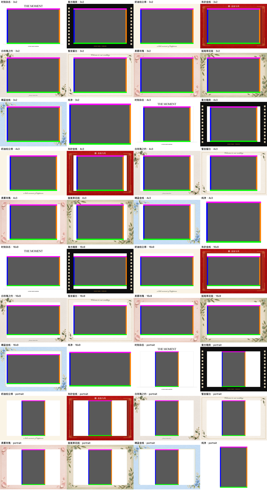
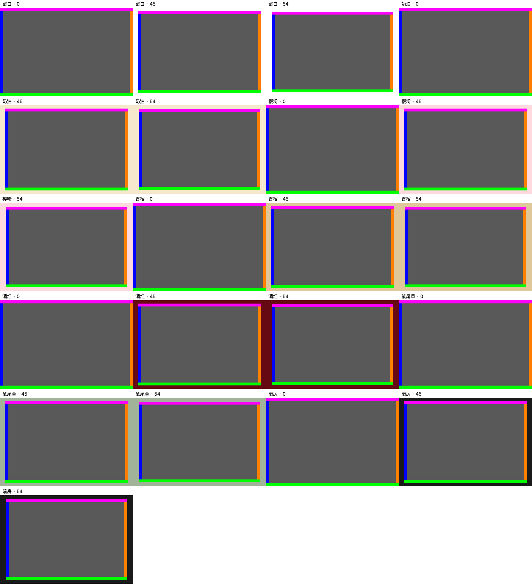

# 3:2 边框生成与合成记录

日期：2026-10-31；对应 build 39 的素材与合成检查。

用户选择“简洁质感”，以花材、纸张和细金线为主，移除原有的大幅卡通人物、气球、大蝴蝶结和拥挤装饰。本次重生成以下六款 PNG 边框；素材自身不嵌入文字、照片或人物。App 中可编辑的文案由渲染器另外合成，因此下方检查图仍可能显示标题与落款。

## 工具与原图保存

全部使用内置 `image_gen__imagegen`，设置 `transparent_background: true`，各款独立调用，没有使用 CLI/API fallback。A 组先查看旧素材，再按全新生成方式调用，没有传入 `referenced_image_paths` 或 `num_last_images_to_include`；B 组查看对应旧素材后，用各自本地旧图作为唯一 `referenced_image_paths` 参考进行重设计，并各尝试一次透明几何定向修正。

最终六张素材均为 **1536×1024、横向 3:2、RGBA PNG**。生成原图按字节直接复制到项目，没有使用 Python 或其他工具修改图像像素。项目素材路径相对仓库根目录；原始生成文件路径以 `$CODEX_HOME` 表示生成时的 Codex 数据目录，仅用于本机来源追溯，项目运行使用表中的资产目录。

| 当前名称 | 视觉方向 | 生成方式 | 最终项目素材 |
|---|---|---|---|
| 誓言留白 | 象牙白棉纸、细金线、少量墨绿细叶 | A：全新生成 | [FrameInvitation](../../SnapBooth/Assets.xcassets/FrameInvitation.imageset/frame.png) |
| 柔雾玫瑰 | 柔雾粉与奶油白纸张、稀疏花瓣、细玫瑰金线 | A：全新生成 | [FrameBlush](../../SnapBooth/Assets.xcassets/FrameBlush.imageset/frame.png) |
| 鼠尾草花园 | 亚麻纸感、鼠尾草与尤加利细叶、克制浅金线 | A：全新生成 | [FrameGarden](../../SnapBooth/Assets.xcassets/FrameGarden.imageset/frame.png) |
| 朱砂金线 | 朱砂红棉纸、克制细金线与小型几何转角 | B：参考旧图重设计，采用 v1 | [FrameChineseFoil](../../SnapBooth/Assets.xcassets/FrameChineseFoil.imageset/frame.png) |
| 白玫瑰之约 | 暖白棉纸、两处小型白玫瑰与绿叶 | B：参考旧图重设计后定向修正，采用 v2 | [FrameFloralPhoto](../../SnapBooth/Assets.xcassets/FrameFloralPhoto.imageset/frame.png) |
| 晴蓝金线 | 淡晴蓝纸张、少量蓝花与细金线 | B：参考旧图重设计，采用 v1 | [FrameCelebration](../../SnapBooth/Assets.xcassets/FrameCelebration.imageset/frame.png) |

## 精确 3:2 开口与照片保护

AI 生成的透明孔仍存在少量羽化边缘，不能把提示词中的几何要求当作逐像素保证。实际显示依赖 [PrintLayoutRenderer.swift](../../SnapBooth/PrintLayoutRenderer.swift) 的统一规则：

- 模板照片开口为归一化 `x=0.10, y=0.10, width=0.80, height=0.80`。在 `1800×1200` 的 6 英寸横向成片中，开口精确为 `x=180, y=120, width=1440, height=960`，自身保持 3:2。
- 图框使用 even-odd 裁剪排除照片开口；源 PNG 中跨入开口的纸纹、暗边或装饰不会覆盖照片。孔外透明残留由与模板匹配的纸张底色填充。
- 普通照片默认“完整画面”适配，不额外裁切源画幅；源照片比例不是 3:2 时保留必要留白。用户主动选择“铺满裁切”时才采用铺满策略；证件照仍使用既有标准尺寸流程。
- 实时构图与最终保存/分享使用同一照片矩形与装饰裁剪规则。这里保证 App 的合成逻辑一致，不将相机直播流与拍摄 JPEG 本身可能存在的视角差异当作已经验证一致。

## build 39 合成检查图

以下为合成测试图，使用灰色测试画面和四边彩色标记检查边界；不是实拍照片，也不是实际出纸记录。模板图覆盖 3:2、4:3、16:9 和竖向输入；简约边框图覆盖不同颜色与留白宽度。彩色四边均应完整保留，边框位于照片外侧。

[查看模板合成检查原图](../screenshots/frames-3x2-build39.png)



[查看简约边框合成检查原图](../screenshots/plain-frames-3x2-build39.png)



## 六款实际 prompt 与最终素材来源

下面保留实际发送的英文 prompt 原文，未用事后概括替代；名称以当前界面为准。A 组生成时仍使用旧名“婚礼请柬／怦然心动／奶油花园”，对应现在的“誓言留白／柔雾玫瑰／鼠尾草花园”。

### 誓言留白 / FrameInvitation

工具模式：A：全新生成；`transparent_background=true`。

最终项目素材：`SnapBooth/Assets.xcassets/FrameInvitation.imageset/frame.png`

采用的生成原图：`$CODEX_HOME/generated_images/01a0f2d8-3d93-7e33-9c36-e2b3bfe8c86f/exec-86511a3f-2153-4d58-97c9-e2cfbd5c0141.png`

实际首次 prompt：

```text
Use case: stylized-concept. Asset type: production PNG overlay for a premium photography studio's 6-inch landscape photo print, NOT a mockup. Generate one finished flat border asset, canvas exactly landscape 3:2 (prefer 1536 x 1024), viewed perfectly straight on with no perspective. The outer border reaches all four canvas edges. It has a truly transparent, sharp rectangular cutout at normalized x=0.10 y=0.10 width=0.80 height=0.80: left edge 10%, right edge 90%, top edge 10%, bottom edge 90%. Thus the hole itself is 3:2. Every pixel in this entire central rectangle must have alpha=0, with no solid white/black/gray fill, no checkerboard, no mist, no gradient, no vignette or shadow in the hole. Opaque paper and all decoration exist exclusively within the outer 10% border bands. No decoration may cross the inner boundary. Refined, understated, tactile stationery rather than cartoon clip art. Preserve a clean uninterrupted horizontal rectangular photo opening. No text, letters, logo, watermark, photos, human figures, cartoon characters, large bows, or thick ornate frame. No external background or extra margin outside the canvas. Transparent PNG alpha is essential.
Theme: minimalist contemporary wedding invitation. Warm ivory white cotton paper with very subtle visible fibers and quiet natural texture. One exceptionally fine champagne-gold foil rectangular hairline lies at 7% inset, entirely outside the transparent photo opening. Only two or three tiny dark sage / ink-green leaf accents on slender stems, very sparse and flat against the paper, safely within the border corners. Mostly beautiful empty warm-white paper. Restrained editorial luxury, no flowers or bouquet masses, no rough torn edge. Rebuild as an elegant blank photo mat.
```

### 柔雾玫瑰 / FrameBlush

工具模式：A：全新生成；`transparent_background=true`。

最终项目素材：`SnapBooth/Assets.xcassets/FrameBlush.imageset/frame.png`

采用的生成原图：`$CODEX_HOME/generated_images/01a0f2d8-3d93-7e33-9c36-e2b3bfe8c86f/exec-8c887719-be6e-4e8d-82dc-01898ab3cbde.png`

实际首次 prompt：

```text
Use case: stylized-concept. Asset type: production PNG overlay for a premium photography studio's 6-inch landscape photo print, NOT a mockup. Generate one finished flat border asset, canvas exactly landscape 3:2 (prefer 1536 x 1024), viewed perfectly straight on with no perspective. The outer border reaches all four canvas edges. It has a truly transparent, sharp rectangular cutout at normalized x=0.10 y=0.10 width=0.80 height=0.80: left edge 10%, right edge 90%, top edge 10%, bottom edge 90%. Thus the hole itself is 3:2. Every pixel in this entire central rectangle must have alpha=0, with no solid white/black/gray fill, no checkerboard, no mist, no gradient, no vignette or shadow in the hole. Opaque paper and all decoration exist exclusively within the outer 10% border bands. No decoration may cross the inner boundary. Refined, understated, tactile stationery rather than cartoon clip art. Preserve a clean uninterrupted horizontal rectangular photo opening. No text, letters, logo, watermark, photos, human figures, cartoon characters, large bows, or thick ornate frame. No external background or extra margin outside the canvas. Transparent PNG alpha is essential.
Theme: refined romantic blush stationery. Muted dusty blush-pink and creamy ivory paper with delicate pressed cotton texture. A single extremely thin rose-gold foil hairline rectangular rule at 7% inset. Just a few tiny realistic pale pink rose petals, tastefully spaced in the outer border bands, subtle soft paper-contact shadows confined to the paper. Abundant uncluttered space. No full rose heads, garlands, ribbons, bows or characters. Sophisticated soft color, low saturation, no glossy plastic or illustration clutter.
```

### 鼠尾草花园 / FrameGarden

工具模式：A：全新生成；`transparent_background=true`。

最终项目素材：`SnapBooth/Assets.xcassets/FrameGarden.imageset/frame.png`

采用的生成原图：`$CODEX_HOME/generated_images/01a0f2d8-3d93-7e33-9c36-e2b3bfe8c86f/exec-7dd3a549-180d-494b-bdb3-f107f49487a2.png`

实际首次 prompt：

```text
Use case: stylized-concept. Asset type: production PNG overlay for a premium photography studio's 6-inch landscape photo print, NOT a mockup. Generate one finished flat border asset, canvas exactly landscape 3:2 (prefer 1536 x 1024), viewed perfectly straight on with no perspective. The outer border reaches all four canvas edges. It has a truly transparent, sharp rectangular cutout at normalized x=0.10 y=0.10 width=0.80 height=0.80: left edge 10%, right edge 90%, top edge 10%, bottom edge 90%. Thus the hole itself is 3:2. Every pixel in this entire central rectangle must have alpha=0, with no solid white/black/gray fill, no checkerboard, no mist, no gradient, no vignette or shadow in the hole. Opaque paper and all decoration exist exclusively within the outer 10% border bands. No decoration may cross the inner boundary. Refined, understated, tactile stationery rather than cartoon clip art. Preserve a clean uninterrupted horizontal rectangular photo opening. No text, letters, logo, watermark, photos, human figures, cartoon characters, large bows, or thick ornate frame. No external background or extra margin outside the canvas. Transparent PNG alpha is essential.
Theme: quiet botanical garden stationery. Warm linen-paper mat with a very faint natural woven texture and a gentle sage-green tint at the outer edges. A few sparse photorealistic small sage and eucalyptus leaves on fine stems, asymmetrically arranged within the outer 10% bands. An extremely fine muted olive / pale antique-gold rectangular hairline at 7% inset, simple and understated. Plenty of open linen paper and soft natural colors, no dense foliage, bouquets, big flowers, vines across the opening, cartoon illustration, or dramatic shadows.
```

### 朱砂金线 / FrameChineseFoil

工具模式：B：参考旧图重设计，采用 v1；`transparent_background=true`。

最终项目素材：`SnapBooth/Assets.xcassets/FrameChineseFoil.imageset/frame.png`

采用的生成原图：`$CODEX_HOME/generated_images/01a18fb4-025c-7fb1-94ed-b0b37f651b94/exec-102879ef-c995-4041-ab31-13d19117bbf0.png`

首次编辑参考：替换前的项目素材 `FrameChineseFoil.imageset/frame.png`。

实际首次 prompt：

```text
Use case: style-transfer. Edit target: the provided legacy photo-frame asset. Replace it with a completely new premium, restrained vermilion-red and fine-gold photo border, keeping only the red/gold cultural theme. Asset for a photobooth overlay, flat front view, landscape canvas 1536 x 1024 (3:2). Thick tactile vermilion cotton-paper texture only in the outer 10% border band. Very fine warm metallic-gold lines and one understated geometric corner detail, generous visual quiet, sophisticated stationery. The exact central rectangle x=10%, y=10%, width=80%, height=80% must be a real alpha=0 transparent cutout with sharp rectangular 90-degree edges. Thus its corners are (10%,10%) and (90%,90%). No pixels, textures, tint, shadow, glow, feathering or objects may enter that rectangle. All design must stay OUTSIDE it, within the outer 10% bands, and the frame extends cleanly to the outer canvas edge. True transparent PNG, not a depicted black or white window, not a checkerboard graphic. No inner black border. No photographs, people, cartoon figures, text, Chinese characters, giant double-happiness symbols, logos, balloons, ribbon bows, confetti, watermark, perspective or drop shadow. Make it minimal and richly textured, with delicate fine gold, not the heavy ornamentation in the reference.
```

### 白玫瑰之约 / FrameFloralPhoto

工具模式：B：参考旧图重设计后定向修正，采用 v2；`transparent_background=true`。

最终项目素材：`SnapBooth/Assets.xcassets/FrameFloralPhoto.imageset/frame.png`

采用的生成原图：`$CODEX_HOME/generated_images/01a18fb4-025c-7fb1-94ed-b0b37f651b94/exec-c04405f2-b79f-4831-897e-aeed1ce85d39.png`

首次编辑参考：替换前的项目素材 `FrameFloralPhoto.imageset/frame.png`。

实际首次 prompt：

```text
Use case: style-transfer. Edit target: the provided legacy floral photo-frame asset. Replace it with a completely new premium minimal warm-ivory cotton-paper and real white-rose photo border. Asset for a photobooth overlay, flat front view, landscape canvas 1536 x 1024 (3:2). Warm white matte cotton-paper texture only in the outer 10% border band; a very small realistic white rose with a few restrained muted green leaves in one corner and one tiny corresponding floral accent in the opposite corner. Delicate, editorial, tactile fine stationery; the photo must dominate. No ribbons. The exact central rectangle x=10%, y=10%, width=80%, height=80% must be a real alpha=0 transparent cutout with sharp rectangular 90-degree edges. Its corners are (10%,10%) and (90%,90%). Every petal, leaf, stem, paper fiber, tint and shadow must stay OUTSIDE that rectangle, fully contained within the outer 10% bands. Do not feather or vignette the hole. Frame extends cleanly to the outer canvas edge. True transparent PNG, not a depicted black or white window, not a checkerboard graphic, no inner black border. No photographs, people, cartoon figures, text, logos, oversized flowers, huge bouquets, bows, balloons, glitter, confetti, watermark, perspective or drop shadow. Less floral mass and far more clean paper than the reference.
```

白玫瑰之约采用 v2。第二次调用唯一参考为首次生成图：

`$CODEX_HOME/generated_images/01a18fb4-025c-7fb1-94ed-b0b37f651b94/exec-3acce487-dcfb-4e38-bf8f-5192c62eea8f.png`

实际第二次 prompt：

```text
Use case: precise-object-edit. This is a real RGBA photo-overlay frame, not a picture of a frame. Keep the supplied frame's exact design, paper colors, flowers/gold details, restrained premium style, and landscape 1536x1024 canvas. CHANGE ONLY THE TRANSPARENCY GEOMETRY. Remove the soft vignette/gradient completely. The central rectangular hole must extend exactly from x=154 to x=1382 and y=102 to y=922: every pixel inside this rectangle must be FULLY TRANSPARENT alpha zero with no colored tint, no blur, no shadow. The surrounding four 10% paper bands must be OPAQUE colored paper, continuing seamlessly up to the cutout edge. Sharp hard rectangular cutout, square corners. No feathering anywhere along the hole. All gold lines and floral petals stay fully OUTSIDE this 154,102 to 1382,922 rectangle, move a flower slightly outward if necessary rather than cut off petals. Do not depict black inside the hole, do not add white inside it, no checkerboard pattern, no dark inner border. Keep no text/no people/no photo/no logo/no balloons/no cartoon/no confetti. Most important: four opaque paper strips framing one crisp true-alpha rectangular hole, like an actual paper mat cut with a knife.
```

### 晴蓝金线 / FrameCelebration

工具模式：B：参考旧图重设计，采用 v1；`transparent_background=true`。

最终项目素材：`SnapBooth/Assets.xcassets/FrameCelebration.imageset/frame.png`

采用的生成原图：`$CODEX_HOME/generated_images/01a18fb4-025c-7fb1-94ed-b0b37f651b94/exec-31fde4f1-e8ae-4619-a4ea-b1c97ed8e005.png`

首次编辑参考：替换前的项目素材 `FrameCelebration.imageset/frame.png`。

实际首次 prompt：

```text
Use case: style-transfer. Edit target: the provided legacy blue celebration photo-frame asset. Replace it with a completely new premium minimal pale-sky-blue paper photo border with restrained fine warm-gold lines and a tiny number of delicate realistic blue flowers in the corners. Asset for a photobooth overlay, flat front view, landscape canvas 1536 x 1024 (3:2). Soft powder-blue tactile cotton-paper texture only in the outer 10% border band, one hairline gold accent, two very modest blue floral touches, luxurious quiet stationery. The exact central rectangle x=10%, y=10%, width=80%, height=80% must be a real alpha=0 transparent cutout with sharp rectangular 90-degree edges. Its corners are (10%,10%) and (90%,90%). All flowers, leaves, gold lines, paper texture, color and shadows must stay OUTSIDE the central rectangle, contained within the outer 10% border bands. No feathered or vignette window edges. Frame extends cleanly to the outer canvas edge. True transparent PNG, not a depicted black or white window, not a checkerboard graphic, no inner black border. No balloons, cartoon figures, people, photographs, text, stars, confetti, glitter, ribbons, large bows, large decorative masses, logos, watermark, perspective or drop shadow. A completely restrained adult aesthetic, replacing the playful legacy artwork.
```

## 选择与 QA 说明

六款均检查了尺寸、RGBA 通道与视觉内容，未发现素材自身嵌入文字、照片、人物或大幅卡通装饰。B 组中朱砂金线选用 v1 的哑光纸感，白玫瑰之约选用 v2 的开口位置，晴蓝金线选用 v1 更细、更克制的金线；另两张未采用的 v2 不进入项目。精确开口依靠代码裁剪保护，未宣称生成源图具有完美的像素级透明孔。

两张合成检查图均从本轮检查输出原样复制，未裁剪、缩放或改色。本次工作没有进行真实打印。
